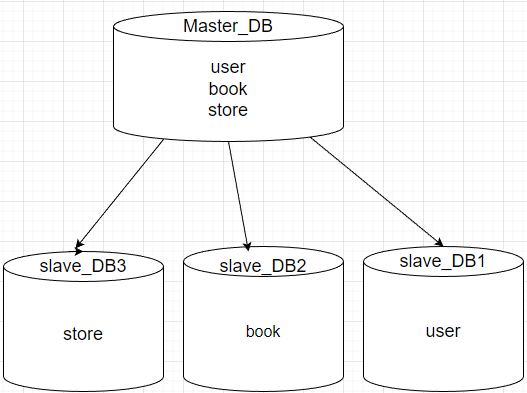
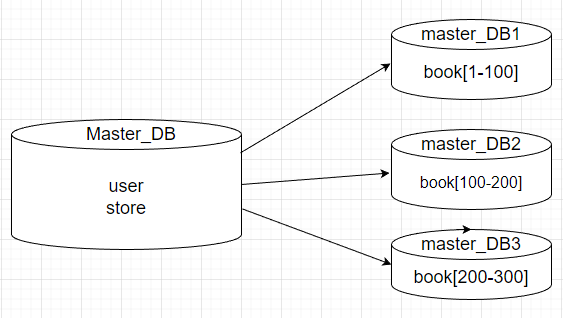

# Домашнее задание к занятию «Репликация и масштабирование. Часть 2», Шаблевский О.Н.

### Задание 1

Опишите основные преимущества использования масштабирования методами:

- активный master-сервер и пассивный репликационный slave-сервер; 
- master-сервер и несколько slave-серверов;
- активный сервер со специальным механизмом репликации — distributed replicated block device (DRBD);
- SAN-кластер.

*Дайте ответ в свободной форме.*  

### Ответ:  

1. *Активный master-сервер и пассивный репликационный slave-сервер* - более надёжная система: если основной сервер упадёт, то на slave находится копия всех данных и её можно будет быстро поднять. При этом важно то, как устроена репликация. Если она синхронная, то транзакцию нужно сохранять одновременно и на master, и на slave, а это может быть медленно. Если репликация асинхронная, то можно потерять часть данных после аварийного переключения;
2. *Master-сервер и несколько slave-серверов* - создание нескольких дополнительных slave‑серверов позволяет снять с основного сервера нагрузку и повысить общую производительность системы, а также можно организовать slave под конкретные ресурсоёмкие задачи и таким образом, например, упростить составление серьёзных аналитических отчётов — используемый для этих целей slave может быть нагружен на 100%, но на работу других пользователей приложения это не повлияет;

---

### Задание 2

Разработайте план для выполнения горизонтального и вертикального шаринга базы данных. База данных состоит из трёх таблиц: 

- пользователи, 
- книги, 
- магазины (столбцы произвольно). 

Опишите принципы построения системы и их разграничение или разбивку между базами данных.

*Пришлите блоксхему, где и что будет располагаться. Опишите, в каких режимах будут работать сервера.*   

### Ответ:  

- Вертикальное разделение (Функциональная разбивка)
Вместо хранения всех таблиц в одной монолитной базе, мы разделяем систему на 3 независимые функциональные базы данных (микросервисные БД). Это устраняет взаимное влияние нагрузок (например, массовый поиск книг не замедлит авторизацию пользователей).
1. БД Пользователей (User DB): Хранит только данные профилей, авторизации и балансов.
2. БД Каталога (Catalog DB): Хранит данные о книгах, авторах, жанрах.
3. БД Магазинов и Складов (Shop DB): Хранит информацию о торговых точках, наличии книг в магазинах и заказах.

- Горизонтальное масштабирование (Шардирование)
Внутри каждой функциональной базы применяется свой метод горизонтального масштабирования:
1. Таблица Пользователи (Шардируется):
	• Критерий: Объемы пользователей растут линейно, их миллионы.
	• Ключ шардирования (Shard Key): user_id.
	• Принцип: Данные распределяются по шардам с помощью хэш-функции (например, hash(user_id) % N). Пользователь с ID 101 попадает на Шард 1, с ID 102 — на Шард 2.
2. Таблица Книги (Реплицируется глобально / Шардируется при огромном каталоге):
	• Принцип: Каталог книг читается в тысячи раз чаще, чем обновляется. Если каталог до 1-2 млн книг, его можно целиком держать на каждом узле каталога. Если это мировой масштаб (сотни миллионов книг), шардируем по book_id.
3. Таблица Магазины (Реплицируется):
	• Принцип: Количество физических или юридических магазинов редко превышает несколько тысяч. Эту таблицу не имеет смысла шардировать. Она полностью дублируется (реплицируется) на все узлы базы данных магазинов, так как объем данных крайне мал.

Режимы работы серверов
Для обеспечения отказоустойчивости (HA) и масштабирования чтения каждый компонент разворачивается в своем кластерном режиме:
1. Маршрутизаторы запросов (API Gateways / Proxies):
	• Работают в режиме Active-Active за балансировщиком нагрузки (например, Nginx/HAProxy). Они принимают запросы от приложения, понимают, куда их направить (в БД пользователей или каталог), и вычисляют нужный шард.
2. Кластер Пользователей (User Shards):
	• Каждый шард (например, Шард 1 и Шард 2) работает в режиме Master-Slave (Primary-Replica).
	• Master принимает записи (регистрация, смена пароля).
	• Slave используется для синхронной/асинхронной репликации и обработки тяжелых чтений (например, выгрузка профиля).
3. Кластер Каталога Книг:
	• Работает в режиме Master с несколькими Read-Slaves. Поскольку книги ищут постоянно, один Master обрабатывает добавление новых книг, а 3–4 реплики (Slaves) обслуживают поисковый трафик клиентов.

